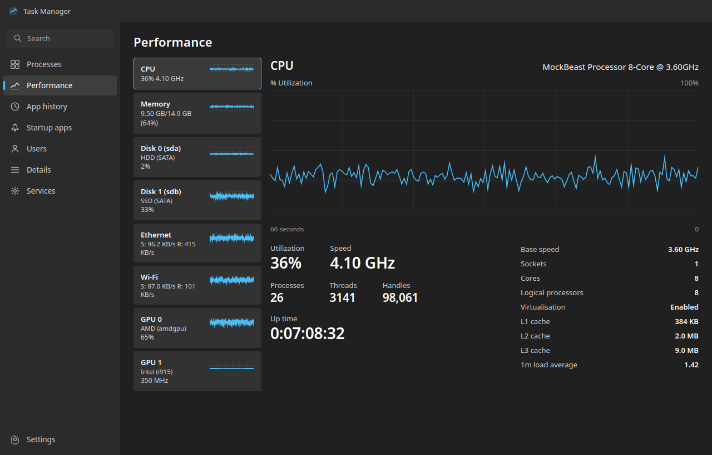

# Windows 11 Task Manager for Linux



A faithful, from-scratch **Task Manager for Linux** that recreates the Windows 11 Task Manager — its layout, its dark Fluent design, its seven pages and its keyboard shortcut. Built with **Electron**, it reads **live system data straight from `/proc` and `/sys`**, so every number on screen is real: your processes, CPU, memory, disks, network, GPUs and services.

If you have ever missed Task Manager after moving to Linux — or wanted a **system monitor that looks like the one you already know** — this is it. No mock data, no dependencies on native libraries: just `/proc`.

  

---

## Table of contents

- [Features](#features)
- [Ctrl+Shift+Esc: the Task Manager hotkey](#ctrlshiftesc-the-task-manager-hotkey)
- [Installation](#installation)
  - [1. AppImage (any Linux distro)](#1-appimage-any-linux-distro)
  - [2. .deb package (Debian / Ubuntu)](#2-deb-package-debian--ubuntu)
  - [3. Build from source](#3-build-from-source)
- [How it works: where every number comes from](#how-it-works-every-number-comes-from-proc)
- [Settings](#settings)
- [System requirements](#system-requirements)
- [Project structure](#project-structure)
- [Roadmap](#roadmap)
- [FAQ](#faq)
- [License and disclaimer](#license-and-disclaimer)

---

## Features

**Processes** — grouped exactly like Windows into **Apps**, **Background processes** and **Windows processes** (here: *System*). Live CPU and memory per process with the same heat-scale colouring, search with `Ctrl+F`, right-click menus, **End task** for any process, and a live status bar showing system-wide CPU, memory, disk and network.

**Performance** — the full two-pane layout:

- Left rail of live thumbnails: **CPU, Memory, each Disk, each network adapter, each GPU**
- 60-second area graph with the `% Utilization` / `100%` / `60 seconds` / `0` axis labels
- Big **Utilization** and **Speed**, a **Processes / Threads / Handles** row, and **Up time** as `d:hh:mm:ss`
- Right-hand spec column: **Base speed, Sockets, Cores, Logical processors, Virtualisation, L1/L2/L3 cache**
- Disk pages report the real media type — **SSD (SATA)** vs **HDD (SATA)** — from `queue/rotational`
- Network pages show per-adapter `S:` / `R:` throughput with an auto-scaled axis

**App history** — CPU time accumulated per application since boot.

**Startup apps** — every XDG autostart entry, with a working **Enable / Disable** toggle that rewrites the `.desktop` entry.

**Users** — signed-in sessions with per-user CPU and memory.

**Details** — a dense sortable table: PID, name, status, user, CPU, memory, threads, description.

**Services** — full systemd service list with **Start / Stop / Restart** and startup type.

**Settings** — update speed, default start page, show-all-users, background behaviour, and the hotkey.

### Extras beyond the original

- **`Ctrl+Shift+Esc` opens Task Manager from anywhere** — same shortcut as Windows
- **Tray icon** — closing the window hides it so the hotkey still works; quit from the tray
- **Single instance** — relaunching raises the running window instead of opening a second one
- **Run new task** dialog for launching a command

---

## Ctrl+Shift+Esc: the Task Manager hotkey

Press **`Ctrl+Shift+Esc`** anywhere on your desktop and the window appears, focused, showing fresh data — exactly how Task Manager behaves on Windows. If the window was closed it is still running in the tray, and this shortcut summons it.

> If your desktop environment has already bound `Ctrl+Shift+Esc` to something else, the shortcut cannot be claimed (the app logs a warning). You can still open it from the app menu or the tray icon, and toggle background mode in **Settings → Keep running in background**.

---

## Installation

### 1. AppImage (any Linux distro)

Works on Ubuntu, Debian, Fedora, Arch, openSUSE and everything else — no root, no package manager needed.

```bash
chmod +x TaskManager-1.1.0.AppImage
./TaskManager-1.1.0.AppImage
```

Run it once to confirm it works, then optionally install it into your desktop menu:

```bash
mkdir -p ~/.local/bin ~/.local/share/applications
cp TaskManager-1.1.0.AppImage ~/.local/bin/task-manager
cat > ~/.local/share/applications/task-manager.desktop <<'EOF'
[Desktop Entry]
Type=Application
Name=Task Manager
Comment=Windows 11 Task Manager for Linux
Exec=%h/.local/bin/task-manager
Icon=task-manager
Terminal=false
Categories=System;Monitor;
EOF
cp app/assets/icon.png ~/.local/share/icons/task-manager.png
update-desktop-database ~/.local/share/applications 2>/dev/null || true
```

**No FUSE?** Some minimal systems need:

```bash
./TaskManager-1.1.0.AppImage --appimage-extract-and-run
```

### 2. .deb package (Debian / Ubuntu)

```bash
sudo apt install ./task-manager_1.1.0_amd64.deb
```

Or with plain `dpkg`:

```bash
sudo dpkg -i task-manager_1.1.0_amd64.deb
sudo apt-get install -f    # resolves any missing dependencies
```

Launch it from your application menu under **System → Task Manager**, or run `task-manager-replica` in a terminal.

Uninstall any time with:

```bash
sudo apt remove task-manager
```

### 3. Build from source

Requires **Node.js 18+** and **npm**. Python 3 is needed only for the `.deb` target.

```bash
git clone https://github.com/USER/windows-11-task-manager-linux.git
cd windows-11-task-manager-linux/app
npm install
```

| Command | Result |
| --- | --- |
| `npm start` | Run the app in development |
| `npm run dist` | Build `TaskManager-<version>.AppImage` into `../dist/` |
| `npm run deb` | Build `task-manager_<version>_amd64.deb` into `../dist/` |

The `.deb` is produced by [`scripts/make-deb.py`](scripts/make-deb.py), which uses `dpkg-deb` directly so you do not need `binutils`/`fpm`.

---

## How it works: every number comes from `/proc`

The collector ([`app/sysinfo.js`](app/sysinfo.js)) is dependency-free Node.js. It walks `/proc` once per second and derives Windows-style figures from Linux sources:

| Windows Task Manager shows | Linux source |
| --- | --- |
| Process list, CPU %, memory, I/O | `/proc/[pid]/stat`, `/statm`, `/status`, `/io`, `/cmdline` |
| Overall and per-core CPU | `/proc/stat` |
| Speed, base speed, sockets, cores, logical processors | `/proc/cpuinfo`, `/sys/devices/system/cpu/cpu0/cpufreq` |
| Virtualisation enabled/disabled | `vmx` / `svm` CPU flags |
| L1 / L2 / L3 cache | `/sys/devices/system/cpu/cpu0/cache/index*` |
| Handles | `/proc/sys/fs/file-nr` |
| Threads | sum of `nr_threads` across `/proc/[pid]/stat` |
| Memory, committed, cached, paged pools | `/proc/meminfo` |
| Disk read/write and active time | `/proc/diskstats` |
| SSD vs HDD media type | `/sys/block/*/queue/rotational` |
| Network throughput per adapter | `/proc/net/dev` |
| GPU utilization, VRAM, clocks | `/sys/class/drm/card*/` |
| Up time, load average | `/proc/uptime`, `/proc/loadavg` |
| Services | `systemctl show --type=service` |
| Startup apps | XDG autostart `.desktop` files |
| Users and sessions | `/etc/passwd`, `/proc/[pid]/environ` |

A 180-sample rolling history feeds the graphs. Nothing is sent anywhere — the app makes no network requests and loads no remote scripts.

---

## Settings

| Setting | What it does |
| --- | --- |
| Real time update speed | Normal (1 s), Low (2 s) or Paused |
| Default start page | Page shown on launch |
| Show processes of all users | Off limits the list to your own processes |
| Keep running in background | Closing the window hides it to the tray so `Ctrl+Shift+Esc` still works. Turn off to quit on close. |
| Global hotkey | Displays the registered shortcut |

---

## System requirements

- **Linux x86_64** with `/proc` and `/sys` mounted (any standard kernel)
- A desktop environment with GTK 3 — the `.deb` pulls in `libgtk-3-0`, `libnss3`, `libxss1`, `libxtst6`, `libnotify4`, `libatspi2.0-0`, `libsecret-1-0`
- **systemd** for the Services page (the app runs, but service control needs `systemctl`)
- A tray-capable panel for the tray icon — GNOME needs the AppIndicator extension

---

## Project structure

```
windows-11-task-manager-linux/
├── app/
│   ├── main.js          # Electron main process, hotkey, tray, IPC
│   ├── preload.js       # contextBridge API (contextIsolation on)
│   ├── sysinfo.js       # /proc + /sys collector — no native deps
│   ├── assets/icon.png  # generated app + tray icon
│   └── src/
│       ├── index.html   # seven-page shell
│       ├── styles.css   # Fluent dark theme
│       └── renderer.js  # tables, graphs, context menus, pages
├── scripts/
│   ├── gen-icon.js      # generates the PNG icon (no image libs)
│   └── make-deb.py      # builds the .deb via dpkg-deb
├── screenshots/
└── README.md
```

**Security model:** `contextIsolation` is enabled, `nodeIntegration` is disabled, and all system access is exposed through a narrow `preload.js` bridge. The renderer carries a Content-Security-Policy that blocks remote scripts.

---

## Roadmap

- Per-core CPU graphs on the Performance page
- Light theme toggle
- GPU utilization on `i915` and proprietary NVIDIA
- Effectiveness/efficiency core breakdown on hybrid CPUs
- Memory pressure and per-process disk I/O columns

Contributions welcome — open an issue first so we can align on direction.

---

## FAQ

**Is this affiliated with Microsoft?**
No. This is an independent, original implementation written for Linux. Windows and Task Manager are trademarks of Microsoft; this project is not endorsed by or connected to Microsoft. No Microsoft code was copied.

**Is any of my data uploaded?**
No. The app reads local kernel interfaces only, makes no outbound network requests, and loads no remote scripts or analytics.

**Why does GPU show `—` for utilization?**
The driver must expose `gpu_busy_percent` (AMD's `amdgpu` often returns `EBUSY`, and Intel's `i915` exposes clocks but no busy percentage). VRAM and clock readings are still shown where available.

**Why can't `Ctrl+Shift+Esc` be registered?**
Your desktop environment or another application already owns that shortcut. Check your DE's keyboard shortcut settings and free it up. The tray menu and app menu still open Task Manager.

**Does it work on Wayland?**
Yes. It is a normal Electron app; it runs on Wayland and X11 alike.

**Why is there no `sudo`?**
Ending a process or controlling services uses your own permissions. Actions needing elevation go through your desktop's polkit agent, exactly like any other system tool.

---

## License and disclaimer

Released under the [MIT License](LICENSE).

This project is an independent re-creation of a user interface for Linux. It is not affiliated with, endorsed by, or connected to Microsoft. All artwork and code here are original.
